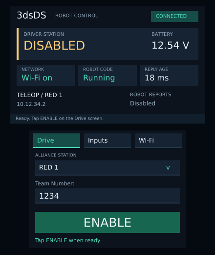

# 3dsDS

An FRC roboRIO driver station for the **New Nintendo 3DS XL**, using its built-in controls and 2.4 GHz Wi-Fi. Launch it from HOME Menu—no PC bridge or external controller required.

**Experimental:** builds and automated tests pass, but physical 3DS Wi-Fi and compatibility with a 2026 roboRIO have not been tested. Intended for practice and bench testing; no FMS support.

[All screens](docs/renders/screens-closed.png) · [Open selectors](docs/renders/selectors-open.png)

These are layout renders, not console screenshots.

## Install

1. Download **3dsDS.cia** from [Releases](https://github.com/CJBrandi/3dsDS/releases).
2. Copy it to your 3DS SD card and install it with **FBI**.
3. Launch **3dsDS** from HOME Menu. Use **HOME** to leave the app.

## Connect and drive

1. In **Setup**, enter your team number. The robot address is automatic: team 1234 → `10.12.34.2`.
2. Open **Wi-Fi** and wait for the scan. Tap **Join** beside the recommended team network, or select another detected network and tap **Join selected network**. Enter its password when prompted.
3. Wait for **CONNECTED** and robot code **Running**. Check your controls on **Inputs**.
4. On **Drive**, select your mode and alliance station. Center the sticks, release the physical controls, and tap **ENABLE**.
5. The entire bottom screen becomes a red **DISABLE** button. Tap anywhere to stop.

The app starts disabled. HOME, sleep, connection loss, or missing robot code also disable it. Returning or reconnecting never enables it automatically. Physical buttons are robot inputs; there are no enable/disable button combos.

For the first hardware test, secure the robot and raise its wheels. **ENABLE REQUESTED** shows what the app requests; **ROBOT REPORTS** shows the robot's reported state.

## Wi-Fi

- Security is detected automatically. Use **WPA2 Personal (AES)** or an open 2.4 GHz network. WPA3-only, enterprise, and hidden networks are unsupported.
- Recommendations appear only for compatible team networks found in a fresh scan. Tap **Scan** to refresh.
- Tap the password field to edit it in the 3DS keyboard. **Show/Hide** reveals or masks the password entered this session.
- Only the **last-used network** is remembered. Joining another replaces the same system Wi-Fi profile. First use chooses an empty profile, or the third profile if all are occupied.
- The app connects to your network; it does not configure the robot radio. Internet access is unnecessary.

## Robot controls

Use WPILib **Joystick** or **GenericHID** on **port 0**. Robot code expecting an Xbox controller needs this mapping instead:

| Input | 3DS control |
| --- | --- |
| Axes 0–1 | Circle Pad X / Y |
| Axes 2–3 | C-stick X / Y |
| Buttons 1–4 | A, B, X, Y |
| Buttons 5–8 | L, R, ZR, ZL |
| Buttons 9–10 | SELECT, START |
| POV 0 | D-pad |

## Development

[Build instructions, tests, protocol details, and release workflow](docs/development.md)

Source is MIT licensed. This project uses AI-generated code and documentation. [Third-party notices](docs/THIRD_PARTY_NOTICES.txt).
